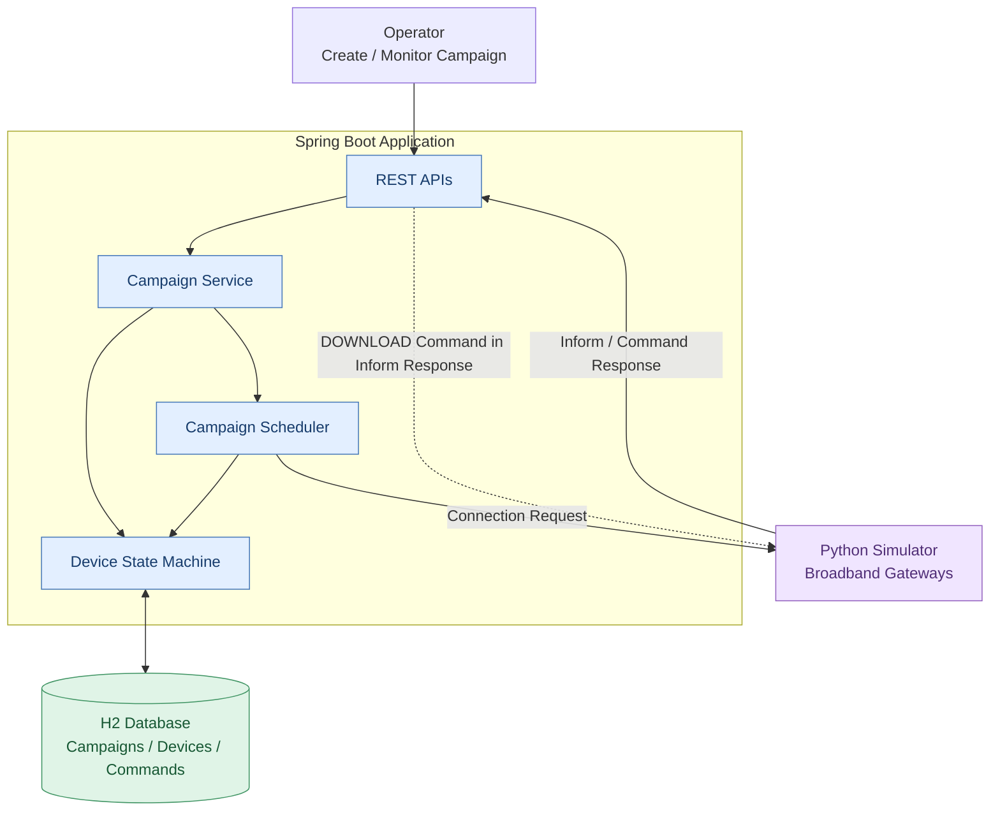
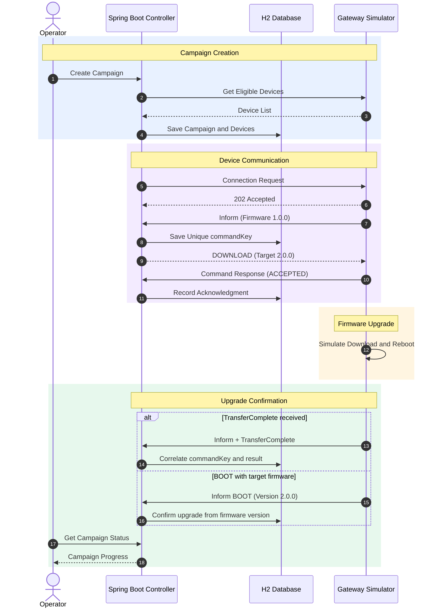
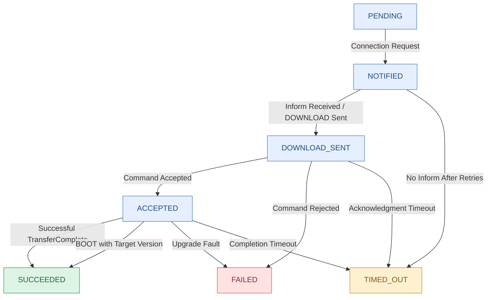

# Firmware Upgrade Campaign Controller

## Overview

Spring Boot-based firmware upgrade campaign management application.

The system manages firmware upgrades across simulated broadband gateways, tracks device progress, handles asynchronous device responses, and provides campaign status reporting.

## Tech Stack

- Java 17
- Spring Boot 4.1.2
- Maven
- Spring Web MVC
- Spring Data JPA
- H2 file-based database
- Spring Boot Actuator
- Spring Scheduler
- Python FastAPI
- Uvicorn
- HTTPX
- Docker
- Docker Compose

## Architecture

The application consists of a Spring Boot controller, an H2 persistent database, and a Python-based gateway simulator.



### Component Responsibilities

- **REST APIs:** Handle campaign management requests and incoming device callbacks.
- **Campaign Service:** Manages campaign creation, progress, and business rules.
- **Campaign Scheduler:** Initiates device upgrades and controls concurrency.
- **Device State Machine:** Tracks individual gateway upgrade states and transitions.
- **H2 Database:** Persists campaigns, device states, command details, and results.
- **Python Simulator:** Simulates gateway inventory, firmware downloads, reboots, failures, and callbacks.

The scheduler, device callback processing, and upgrade execution shown in the architecture represent the intended completed system.

## Firmware Upgrade Sequence

The controller initiates an upgrade by sending a connection request to a gateway. The gateway then opens a session using the Inform API, allowing the controller to issue a DOWNLOAD command.



### Upgrade Flow

1. An operator creates a firmware upgrade campaign.
2. The controller retrieves eligible gateways from the simulator inventory.
3. The scheduler selects gateways based on the maximum concurrent upgrade limit.
4. The controller sends connection requests.
5. Gateways initiate sessions using the Inform API.
6. The controller returns a DOWNLOAD command with a unique `commandKey`.
7. Gateways acknowledge the command, simulate the firmware download, and reboot.
8. The controller processes BOOT or TRANSFER_COMPLETE callbacks.
9. The corresponding device state and campaign progress are updated in H2.

The `deviceId` identifies a gateway, while the `commandKey` uniquely identifies a specific firmware upgrade command.

## Device State Machine

Each gateway progresses through a set of states during its firmware upgrade lifecycle.



### State Descriptions

| State | Description |
|---|---|
| PENDING | Gateway is eligible but has not been contacted |
| NOTIFIED | Connection request sent; waiting for device Inform |
| DOWNLOAD_SENT | Download command issued; waiting for acknowledgment |
| ACCEPTED | Gateway accepted the firmware download command |
| SUCCEEDED | Upgrade confirmed through completion or firmware version evidence |
| FAILED | Gateway rejected the command or reported an upgrade fault |
| TIMED_OUT | Device did not respond or complete within the configured deadline |

The completed controller is intended to handle duplicate callbacks idempotently, correlate delayed events using `commandKey`, and recover unfinished campaigns after controller restarts.

## Package Structure

```text
device.simulator
├── controller
│   └── CampaignController
├── dto
│   ├── CreateCampaignRequest
│   └── CampaignStatusResponse
├── entity
│   ├── Campaign
│   ├── CampaignDevice
│   └── UpgradeCommand
├── repository
│   ├── CampaignRepository
│   ├── CampaignDeviceRepository
│   └── UpgradeCommandRepository
├── service
│   └── CampaignService
├── scheduler
│   └── CampaignScheduler (planned)
└── DeviceSimulatorApplication
```

Device callback controllers and related DTOs will be added as the upgrade workflow is implemented.

## Design Decisions

- **Single Spring Boot application**
  - **Why:** Simple architecture with fewer deployment dependencies.
  - **Trade-off:** The initial implementation does not support horizontal scaling.

- **H2 file-based database**
  - **Why:** Lightweight persistent database with straightforward Spring Data JPA integration.
  - **Trade-off:** PostgreSQL or another shared database would be preferred for multiple production instances.

- **Separate Campaign, CampaignDevice, and UpgradeCommand entities**
  - **Why:** Separates overall campaign configuration, per-device progress, and individual firmware download commands.
  - **Trade-off:** Adds a small amount of database and repository code but improves command tracking and auditability.

- **Scheduler-based upgrade orchestration**
  - **Why:** Controls the number of concurrent upgrades without keeping HTTP requests open while gateways reboot.
  - **Trade-off:** Scheduler interval affects how quickly pending devices are processed.

- **Unique commandKey**
  - **Why:** Correlates asynchronous acknowledgments and completion callbacks with the original DOWNLOAD command.
  - **Trade-off:** Requires persistent command tracking and duplicate-event handling.

- **BOOT-based firmware confirmation**
  - **Why:** Some gateways may upgrade successfully without reporting TransferComplete.
  - **Trade-off:** Firmware version evidence must be matched against the active upgrade.

- **Bounded retries and timeouts**
  - **Why:** Prevents offline or unresponsive gateways from blocking campaign progress indefinitely.
  - **Trade-off:** Late callbacks may arrive after a timeout decision.

- **Automatic campaign halt**
  - **Why:** Prevents continued rollout when the observed failure rate exceeds the configured threshold.
  - **Trade-off:** Requires a minimum sample size to avoid stopping campaigns prematurely.

## REST APIs

| Method | Endpoint | Description | Status |
|---|---|---|---|
| POST | `/campaigns` | Create firmware upgrade campaign | Implemented |
| GET | `/campaigns/{id}` | Retrieve campaign progress | Implemented |
| POST | `/campaigns/{id}/pause` | Pause campaign | Implemented |
| POST | `/campaigns/{id}/resume` | Resume campaign | Implemented |
| POST | `/devices/{deviceId}/inform` | Process gateway Inform event | Planned |
| POST | `/devices/{deviceId}/command-response` | Process command acknowledgment | Planned |

The campaign APIs have been manually validated. Actual device upgrade scheduling and callback handling are not yet implemented.

## Campaign Request Example

```json
{
  "targetVersion": "2.0.0",
  "imageUrl": "https://example.com/firmware/2.0.0.bin",
  "deviceFilter": {
    "currentVersion": "1.0.0"
  },
  "maxConcurrent": 3,
  "failureThresholdPercent": 20
}
```

The campaign targets gateways running firmware version `1.0.0` for an upgrade to `2.0.0`.

The configuration limits upgrades to three in-flight devices once the scheduler is implemented.

## Run Locally

### Maven

Build and test:

```cmd
mvnw.cmd clean package
```

Start:

```cmd
mvnw.cmd spring-boot:run
```

Verify:

```cmd
curl http://localhost:8080/actuator/health
```

Expected:

```json
{
  "status": "UP"
}
```

### Docker Compose

Build the application:

```cmd
mvnw.cmd clean package
```

Start:

```cmd
docker compose up --build -d
```

Verify:

```cmd
curl http://localhost:8080/actuator/health
```

Stop:

```cmd
docker compose down
```

A Docker volume preserves the file-backed H2 database when the container is stopped or recreated.

Local Maven execution and Docker Compose use separate H2 database storage locations.

## Run Device Simulator

The project uses a Python FastAPI-based simulator for testing firmware upgrade campaigns against simulated broadband gateways.

The simulator provides a device inventory, accepts connection requests, and generates asynchronous firmware upgrade events.

### Prerequisites

Install Python dependencies:

```cmd
py -m pip install fastapi uvicorn httpx
```

### Start Simulator

A Windows startup script is available at:

`simulator/run-simulator.cmd`

The script centralizes configuration and starts Uvicorn on port `9000`.

From the project root:

```cmd
simulator\run-simulator.cmd
```

### Simulator Configuration

| Variable | Value | Description |
|---|---|---|
| CONTROLLER_URL | http://localhost:8080 | Spring Boot controller URL |
| DEVICE_COUNT | 10 | Number of simulated gateways |
| PERIODIC_INFORM_SEC | 300 | Periodic Inform interval in seconds |
| DOWNLOAD_MIN_SEC | 2 | Minimum simulated download duration |
| DOWNLOAD_MAX_SEC | 5 | Maximum simulated download duration |
| REBOOT_MIN_SEC | 2 | Minimum simulated reboot duration |
| REBOOT_MAX_SEC | 5 | Maximum simulated reboot duration |

These values can be changed in `run-simulator.cmd`.

### Verify Simulator

Retrieve gateway inventory:

```cmd
curl http://localhost:9000/devices
```

Retrieve gateways running version `1.0.0`:

```cmd
curl "http://localhost:9000/devices?version=1.0.0"
```

The initial simulator configuration contains 10 gateways running firmware version `1.0.0`.

### Run Controller and Simulator Together

Open separate VS Code terminals.

**Terminal 1 — Spring Boot Controller**

```cmd
mvnw.cmd spring-boot:run
```

**Terminal 2 — Python Simulator**

```cmd
simulator\run-simulator.cmd
```

**Terminal 3 — API Validation**

```cmd
curl http://localhost:8080/actuator/health
curl http://localhost:9000/devices
```

The controller runs on port `8080`, and the simulator runs on port `9000`.

If running the controller through Docker while the simulator runs directly on Windows, configure the simulator base URL appropriately, such as `http://host.docker.internal:9000`.

## Campaign API Validation

Campaign management APIs were manually validated using `curl` with a simulator fleet of 10 gateways.

### Create Campaign

Create `campaign-request.json` in the project root using the campaign request shown earlier.

Execute:

```cmd
curl -X POST http://localhost:8080/campaigns -H "Content-Type: application/json" --data-binary "@campaign-request.json"
```

Example response structure:

```json
{
  "campaignId": "generated-uuid",
  "status": "RUNNING",
  "targetVersion": "2.0.0",
  "totalDevices": 10,
  "deviceCounts": {
    "PENDING": 10
  },
  "failureRatePercent": 0.0
}
```

The campaign ID is generated at runtime.

A new campaign record is saved in H2, and each eligible gateway is associated with the campaign in the `PENDING` state.

At this stage, `RUNNING` means the campaign is eligible for scheduling. Firmware upgrades do not begin until the scheduler is implemented.

### Retrieve Campaign Status

Replace `CAMPAIGN_ID` with the generated campaign ID:

```cmd
curl http://localhost:8080/campaigns/CAMPAIGN_ID
```

Verified that the API returns the campaign status, target version, total device count, counts by device state, and failure rate.

### Pause Campaign

```cmd
curl -X POST http://localhost:8080/campaigns/CAMPAIGN_ID/pause
```

Verified transition:

`RUNNING → PAUSED`

### Resume Campaign

```cmd
curl -X POST http://localhost:8080/campaigns/CAMPAIGN_ID/resume
```

Verified transition:

`PAUSED → RUNNING`

The current pause/resume functionality persists campaign status. The scheduler will enforce stopping new upgrade operations while the campaign is paused.

### Additional API Behavior

The following state validations are implemented:

| Scenario | Expected Result |
|---|---|
| Pause RUNNING campaign | 200 OK |
| Pause already PAUSED campaign | 409 Conflict |
| Resume PAUSED campaign | 200 OK |
| Resume already RUNNING campaign | 409 Conflict |
| Retrieve unknown campaign | 404 Not Found |

These error cases should be included in regression testing.

## H2 Database Validation

The application uses a persistent H2 database rather than an in-memory database.

### Configuration

The application configuration is maintained in:

`src/main/resources/application.yaml`

Key settings:

```yaml
spring:
  datasource:
    url: jdbc:h2:file:./data/firmwaredb;DB_CLOSE_ON_EXIT=FALSE
    driver-class-name: org.h2.Driver
    username: sa
    password:

  jpa:
    hibernate:
      ddl-auto: update
    open-in-view: false

  h2:
    console:
      enabled: true
      path: /h2-console
```

### Open H2 Console

URL:

`http://localhost:8080/h2-console`

Connection details:

- JDBC URL: `jdbc:h2:file:./data/firmwaredb;DB_CLOSE_ON_EXIT=FALSE`
- Username: `sa`
- Password: blank

### Verify Campaign Records

```sql
SELECT ID, TARGET_VERSION, SOURCE_VERSION, STATUS
FROM CAMPAIGNS;
```

### Verify Device Records

```sql
SELECT CAMPAIGN_ID, DEVICE_ID, CURRENT_VERSION, STATE
FROM CAMPAIGN_DEVICES;
```

### Verify Device Counts

```sql
SELECT CAMPAIGN_ID, STATE, COUNT(*) AS DEVICE_COUNT
FROM CAMPAIGN_DEVICES
GROUP BY CAMPAIGN_ID, STATE;
```

### Verify Pause and Resume Persistence

```sql
SELECT ID, STATUS
FROM CAMPAIGNS
WHERE ID = 'YOUR_CAMPAIGN_ID';
```

The campaign status was verified through both the REST API and H2 database after pause and resume operations.

### Multiple Campaigns

Each POST request to `/campaigns` creates a new campaign with a generated UUID, even when the request parameters are identical.

Therefore, repeated tests may create multiple campaign records. Each campaign maintains its own device records.

Protection against overlapping active campaigns for the same gateway is a future enhancement.

## Testing Approach

### Tests Completed

- Maven build and Spring Boot startup
- Spring Boot Actuator health check
- Docker Compose startup and health validation
- H2 schema creation and persistence setup
- Python simulator inventory retrieval
- Campaign creation with 10 eligible gateways
- Campaign status retrieval
- Pause and resume operations
- H2 verification of campaign and associated device records

### Tests Pending

- Device Inform callback processing
- DOWNLOAD command generation and acknowledgment
- BOOT and TRANSFER_COMPLETE processing
- Command correlation using `commandKey`
- Duplicate and delayed callbacks
- Firmware upgrade failure and timeout scenarios
- Maximum concurrent upgrade enforcement
- Automatic failure-threshold halt
- Restart recovery with in-flight upgrades
- Custom upgrade metrics
- End-to-end validation with 10–20 and 1,000 gateways

## Observability

Spring Boot Actuator currently exposes:

- `/actuator/health` — Application health
- `/actuator/metrics` — Application and HTTP metrics

Additional planned metrics include:

- Connection requests sent and failed
- Download commands issued
- Command acceptances and rejections
- Successful firmware upgrades
- Failed and timed-out upgrades
- In-flight upgrade counts
- HTTP request counts grouped by endpoint and response status

## Limitations and Trade-offs

- The application currently runs as a single Spring Boot instance.
- H2 file-based storage is suitable for local development but not multi-instance production operation.
- The Python simulator does not download real firmware images.
- Device upgrade execution and scheduling are still under development.
- Concurrent upgrades for the same gateway across overlapping campaigns are not yet prevented.
- Authentication, authorization, and firmware image verification are outside the current implementation.
- Large-scale deployments would require shared persistence, distributed scheduling, rate limiting, and scalable event processing.

## Implementation Status

### Completed

- Spring Boot 4.1.2 project with Java 17 and Maven
- Dockerfile and Docker Compose configuration
- Local and Docker-based health check validation
- H2 file-based database setup
- Campaign, CampaignDevice, and UpgradeCommand JPA entities
- Spring Data JPA repositories
- Campaign creation and inventory integration
- Campaign status reporting
- Campaign pause and resume operations
- Python simulator startup script
- Manual REST API and H2 database validation
- Architecture and design documentation

### In Progress / Planned

- Device Inform and Command Response APIs
- DOWNLOAD command generation and correlation
- Campaign scheduler
- Concurrency limit enforcement
- Firmware upgrade completion tracking
- Failure handling and timeout policies
- Duplicate callback and late-event processing
- Upgrade-specific metrics
- Full simulator integration testing
- Final campaign run report

## Future Improvements

For managing significantly larger device fleets, the architecture could evolve to include:

- Multiple stateless controller instances
- Shared relational database
- Distributed campaign scheduling
- Queue-based or event-driven orchestration
- Partitioned processing by gateway or campaign
- Rate-limited connection requests
- Distributed metrics and operational dashboards
- Campaign audit history and advanced reporting