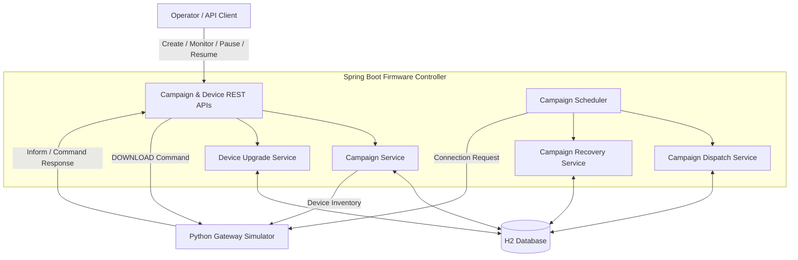
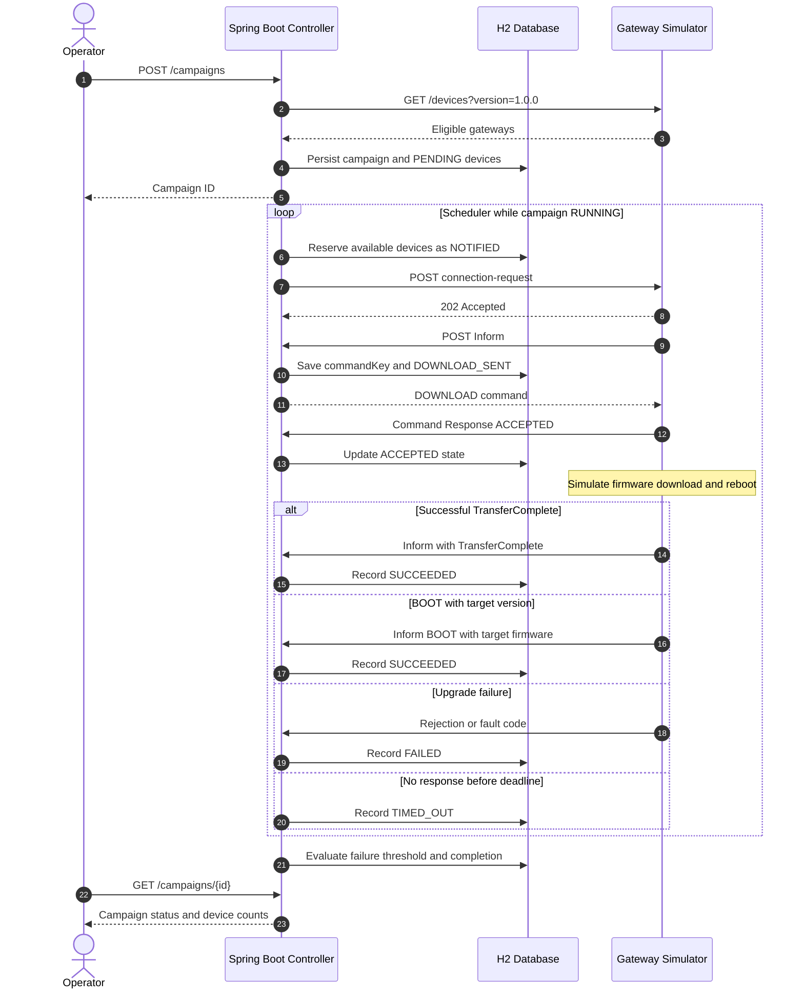
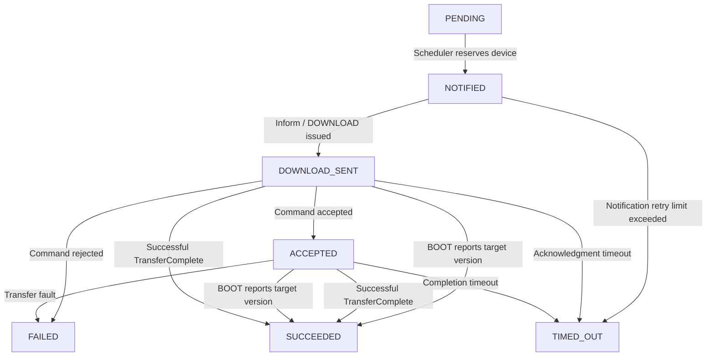

# Firmware Upgrade Campaign Controller

A Java/Spring Boot application for managing firmware upgrade campaigns across a fleet of simulated broadband gateways.

The application provides campaign management APIs, persistent device and command tracking, asynchronous gateway communication, scheduled upgrade orchestration, concurrency limits, and recovery controls.

## Technology Stack

- Java 17 (compile target)
- Spring Boot 4.1.2
- Maven
- Spring Web MVC
- Spring Data JPA
- Spring Scheduling
- Spring Boot Actuator
- H2 file-based database
- Python 3
- FastAPI, Uvicorn, HTTPX
- Docker and Docker Compose

## Architecture



### Component Responsibilities

| Component | Responsibility |
|---|---|
| CampaignController | Campaign creation, status, pause, resume |
| CampaignService | Campaign management and device inventory integration |
| CampaignScheduler | Periodic dispatch, recovery, and lifecycle evaluation |
| CampaignDispatchService | Device reservations and concurrency limits |
| CampaignRecoveryService | Timeouts, notification retries, failure threshold, completion |
| DeviceController | Gateway Inform and command-response endpoints |
| DeviceUpgradeService | DOWNLOAD command issuance, acknowledgments, completion |
| H2 Database | Persistent campaign, device, and command records |
| Python Simulator | Simulated gateway behavior and asynchronous callbacks |

## Firmware Upgrade Sequence



### Important Identifiers

**deviceId** identifies a simulated gateway.

**commandKey** uniquely identifies a DOWNLOAD command and correlates asynchronous acknowledgments and completion events.

Each command key is persisted before the DOWNLOAD response is returned.

## Device Upgrade State Machine



### Device State Descriptions

| State | Meaning |
|---|---|
| PENDING | Device eligible but not yet scheduled |
| NOTIFIED | Connection request initiated; awaiting Inform |
| DOWNLOAD_SENT | DOWNLOAD command issued |
| ACCEPTED | Device acknowledged DOWNLOAD |
| SUCCEEDED | Upgrade success confirmed |
| FAILED | Command rejected or upgrade fault reported |
| TIMED_OUT | Operation exceeded configured deadline |

`SUCCEEDED`, `FAILED`, and `TIMED_OUT` are terminal states in the current MVP.

The implementation does not automatically resend a DOWNLOAD command after its delivery becomes uncertain.

## Project Structure

```text
device-simulator/
├── src/
│   ├── main/
│   │   ├── java/device/simulator/
│   │   │   ├── DeviceSimulatorApplication.java
│   │   │   ├── controller/
│   │   │   │   ├── CampaignController.java
│   │   │   │   └── DeviceController.java
│   │   │   ├── dto/
│   │   │   │   ├── CreateCampaignRequest.java
│   │   │   │   ├── CampaignStatusResponse.java
│   │   │   │   ├── DeviceInformRequest.java
│   │   │   │   └── DeviceCommandResponse.java
│   │   │   ├── entity/
│   │   │   │   ├── Campaign.java
│   │   │   │   ├── CampaignDevice.java
│   │   │   │   └── UpgradeCommand.java
│   │   │   ├── repository/
│   │   │   │   ├── CampaignRepository.java
│   │   │   │   ├── CampaignDeviceRepository.java
│   │   │   │   └── UpgradeCommandRepository.java
│   │   │   ├── service/
│   │   │   │   ├── CampaignService.java
│   │   │   │   ├── CampaignDispatchService.java
│   │   │   │   ├── CampaignRecoveryService.java
│   │   │   │   └── DeviceUpgradeService.java
│   │   │   └── scheduler/
│   │   │       └── CampaignScheduler.java
│   │   └── resources/
│   │       └── application.yaml
│   └── test/
│       └── java/device/simulator/
│           └── DeviceSimulatorApplicationTests.java
├── simulator/
│   ├── device_simulator.py
│   └── run-simulator.cmd
├── campaign-request.json
├── compose.yml
├── mvnw.cmd
└── README.md
```

## Prerequisites

- JDK 17 or later
- Python 3
- Maven wrapper included with the project
- Docker Desktop (optional)
- Windows Command Prompt or VS Code terminal

The project compiles to Java 17 bytecode, even when a newer JDK is installed.

## Application Configuration

Configuration is maintained in:

`src/main/resources/application.yaml`

### H2 Configuration

```yaml
spring:
  datasource:
    url: jdbc:h2:file:./data/firmwaredb;DB_CLOSE_ON_EXIT=FALSE
    driver-class-name: org.h2.Driver
    username: sa
    password:

  jpa:
    hibernate:
      ddl-auto: update

  h2:
    console:
      enabled: true
      path: /h2-console
```

### Simulator and Campaign Configuration

```yaml
simulator:
  base-url: ${SIMULATOR_BASE_URL:http://localhost:9000}

campaign:
  scheduler-delay-ms: 2000
  max-notification-attempts: 3
  notification-timeout-seconds: 15
  acknowledgment-timeout-seconds: 20
  upgrade-timeout-seconds: 90
  failure-min-sample-size: 5
```

These timeout values are configured for local MVP testing, not production use.

### Configuration Parameters

| Parameter | Description |
|---|---|
| scheduler-delay-ms | Delay between scheduler executions |
| max-notification-attempts | Maximum connection request attempts, including initial attempt |
| notification-timeout-seconds | Time to wait for device Inform |
| acknowledgment-timeout-seconds | Time to wait for DOWNLOAD acknowledgment |
| upgrade-timeout-seconds | Time to wait for upgrade completion |
| failure-min-sample-size | Minimum terminal outcomes before evaluating failure threshold |

## Build and Run Locally

Open VS Code and navigate to the project root:

```cmd
cd C:\my_springboot\device-simulator
```

### Build

```cmd
mvnw.cmd clean package
```

Expected:

```text
BUILD SUCCESS
```

The Maven context-loading test uses a separate in-memory H2 database to avoid interfering with the persistent application database.

### Start Spring Boot

```cmd
mvnw.cmd spring-boot:run
```

The controller runs on port `8080`.

Verify:

```cmd
curl http://localhost:8080/actuator/health
```

Expected:

```json
{"status":"UP"}
```

## Python Gateway Simulator

The Python simulator provides:

- Gateway inventory
- Connection request handling
- Periodic Inform events
- DOWNLOAD command acknowledgments
- Firmware download simulation
- Reboot simulation
- Successful completion callbacks
- Rejected commands and transfer failures
- Offline, delayed, and duplicate-event scenarios

### Install Dependencies

```cmd
py -m pip install fastapi uvicorn httpx
```

### Windows Startup Script

The `simulator/run-simulator.cmd` script contains:

```bat
@echo off
cd /d "%~dp0.."

set CONTROLLER_URL=http://localhost:8080
set DEVICE_COUNT=10
set PERIODIC_INFORM_SEC=300
set DOWNLOAD_MIN_SEC=2
set DOWNLOAD_MAX_SEC=5
set REBOOT_MIN_SEC=2
set REBOOT_MAX_SEC=5

py -m uvicorn device_simulator:app --app-dir simulator --port 9000
```

The script avoids manually setting environment variables before every test.

No Python `.env` file is required.

### Start Simulator

From the project root:

```cmd
simulator\run-simulator.cmd
```

The simulator listens on port `9000`.

### Validate Device Inventory

```cmd
curl http://localhost:9000/devices
```

Filter by source firmware version:

```cmd
curl "http://localhost:9000/devices?version=1.0.0"
```

With the local test configuration, the simulator initializes 10 gateways using firmware version `1.0.0`.

Restarting the simulator resets its simulated device state, but does not erase the controller's persisted H2 campaign records.

## Docker Compose

Build the application:

```cmd
mvnw.cmd clean package
```

Start:

```cmd
docker compose up --build -d
```

Check health:

```cmd
curl http://localhost:8080/actuator/health
```

Stop:

```cmd
docker compose down
```

When Spring Boot runs inside Docker and Python runs on the Windows host, configure:

```text
SIMULATOR_BASE_URL=http://host.docker.internal:9000
```

through the container environment or Compose configuration.

The local Maven execution and Docker execution may use different H2 storage locations.

## REST APIs

| Method | Endpoint | Description |
|---|---|---|
| POST | /campaigns | Create campaign |
| GET | /campaigns/{id} | Retrieve campaign status |
| POST | /campaigns/{id}/pause | Pause campaign |
| POST | /campaigns/{id}/resume | Resume campaign |
| POST | /devices/{deviceId}/inform | Process gateway Inform |
| POST | /devices/{deviceId}/command-response | Process DOWNLOAD acknowledgment |

## Create Firmware Upgrade Campaign

Create `campaign-request.json` in the project root:

```json
{
  "targetVersion": "2.0.0",
  "imageUrl": "https://example.com/firmware/2.0.0.bin",
  "deviceFilter": {
    "currentVersion": "1.0.0"
  },
  "maxConcurrent": 3,
  "failureThresholdPercent": 20
}
```

Execute:

```cmd
curl -X POST http://localhost:8080/campaigns -H "Content-Type: application/json" --data-binary "@campaign-request.json"
```

Example initial response:

```json
{
  "campaignId": "generated-uuid",
  "status": "RUNNING",
  "targetVersion": "2.0.0",
  "totalDevices": 10,
  "deviceCounts": {
    "PENDING": 10
  },
  "failureRatePercent": 0.0
}
```

Each POST creates a new campaign with a unique identifier.

The controller queries the simulator for eligible gateways and persists the campaign and gateway records.

## Campaign Status

```cmd
curl http://localhost:8080/campaigns/CAMPAIGN_ID
```

The response includes:

- Campaign ID
- Campaign status
- Target firmware version
- Total eligible gateways
- Device counts grouped by state
- Observed failure percentage

## Pause and Resume

### Pause

```cmd
curl -X POST http://localhost:8080/campaigns/CAMPAIGN_ID/pause
```

Expected transition:

```text
RUNNING -> PAUSED
```

### Resume

```cmd
curl -X POST http://localhost:8080/campaigns/CAMPAIGN_ID/resume
```

Expected transition:

```text
PAUSED -> RUNNING
```

The scheduler only initiates new upgrades for `RUNNING` campaigns.

Already-running upgrades may continue to report completion events while the campaign is paused.

The current recovery service does not evaluate paused campaigns for timeouts.

## Device Inform API

Endpoint:

```text
POST /devices/{deviceId}/inform
```

Example request:

```json
{
  "deviceId": "DEVICE_ID",
  "firmwareVersion": "1.0.0",
  "event": "PERIODIC"
}
```

When no upgrade is assigned:

```json
{
  "commands": []
}
```

When an upgrade is scheduled:

```json
{
  "commands": [
    {
      "type": "DOWNLOAD",
      "commandKey": "generated-command-uuid",
      "url": "https://example.com/firmware/2.0.0.bin",
      "targetVersion": "2.0.0"
    }
  ]
}
```

The command key is persisted before the controller returns the DOWNLOAD command.

## Device Command Response API

Endpoint:

```text
POST /devices/{deviceId}/command-response
```

Example:

```json
{
  "commandKey": "generated-command-uuid",
  "status": "ACCEPTED"
}
```

The device may also return `REJECTED` with an optional reason.

On acceptance, the controller transitions the device to `ACCEPTED` and records an upgrade completion deadline.

On rejection, it records `FAILED`.

## Upgrade Completion Processing

The controller recognizes:

- Successful TransferComplete events
- Nonzero TransferComplete fault codes
- BOOT events reporting the target firmware version
- Duplicate callbacks for already-terminal devices in basic cases

A successful TransferComplete is treated as a successful upgrade outcome in this simplified MVP.

A more rigorous production implementation would require independent confirmation of the firmware version after reboot.

## Campaign Scheduler

The scheduler uses Spring's `@Scheduled` mechanism, enabled with:

```java
@EnableScheduling
```

### Scheduler Workflow

1. Retrieve campaigns with active or halted rollout state.
2. Recover expired in-flight operations.
3. Evaluate failure threshold and completion.
4. Skip additional dispatch if the campaign is no longer RUNNING.
5. Count current in-flight gateways.
6. Calculate available capacity.
7. Reserve eligible PENDING gateways.
8. Persist NOTIFIED state.
9. Send connection requests to the simulator.
10. Process asynchronous callbacks and advance device states.

### Concurrency Control

Active states:

```text
NOTIFIED
DOWNLOAD_SENT
ACCEPTED
```

Available slots:

```text
availableSlots = maxConcurrent - activeDevices
```

For a campaign configured with `maxConcurrent = 3`, the scheduler is designed to maintain no more than three in-flight gateways during normal single-instance operation.

The reservation service checks whether a gateway is already participating in another active campaign.

This implementation does not use distributed locking and does not guarantee atomic cross-campaign ownership under all concurrent callback conditions.

## Timeout Recovery and Retry Policy

The recovery service detects devices whose deadlines have expired.

| Device State | Action |
|---|---|
| NOTIFIED | Retry connection request up to configured limit |
| DOWNLOAD_SENT | Mark TIMED_OUT |
| ACCEPTED | Mark TIMED_OUT |
| SUCCEEDED | No retry |
| FAILED | No retry |
| TIMED_OUT | No retry |

### Safe Retry Strategy

Only connection requests are retried automatically.

DOWNLOAD commands are not blindly resent because the device may have received the command even if the controller did not receive its acknowledgment.

This avoids unnecessary duplicate firmware upgrades.

### Terminal Timeout

When retries are exhausted or a later-stage deadline expires:

```text
State = TIMED_OUT
Deadline = null
LastError = timeout reason
```

The corresponding device no longer occupies an in-flight upgrade slot.

## Failure Threshold and Automatic Halt

The controller calculates failure rate from terminal device outcomes.

```text
failureRatePercent =
    (FAILED + TIMED_OUT) /
    (SUCCEEDED + FAILED + TIMED_OUT) * 100
```

The threshold is evaluated only after the configured minimum number of terminal outcomes has been reached.

Example:

```text
failureThresholdPercent = 20
failureMinSampleSize = 5
```

If more than 20% of terminal outcomes are failures after at least five devices reach terminal states, the campaign becomes:

```text
HALTED
```

Once halted:

- No additional pending devices are selected.
- Existing in-flight upgrades may complete.
- Existing in-flight devices may still time out.
- The campaign remains halted when unscheduled pending devices remain.

## Campaign Completion

A campaign becomes:

```text
COMPLETED
```

when every enrolled gateway reaches a terminal state:

```text
SUCCEEDED
FAILED
TIMED_OUT
```

A completed campaign may contain both successful and unsuccessful upgrades.

If all devices are terminal, completion takes precedence over the failure-threshold halt check in the current MVP.

## H2 Database Validation

Open:

```text
http://localhost:8080/h2-console
```

Connection settings:

```text
Driver: org.h2.Driver
JDBC URL: jdbc:h2:file:./data/firmwaredb;DB_CLOSE_ON_EXIT=FALSE
Username: sa
Password: blank
```

### Verify Campaigns

```sql
SELECT
    ID,
    TARGET_VERSION,
    SOURCE_VERSION,
    STATUS,
    CREATED_AT
FROM CAMPAIGNS
ORDER BY CREATED_AT DESC;
```

### Verify Campaign Devices

```sql
SELECT
    CAMPAIGN_ID,
    DEVICE_ID,
    CURRENT_VERSION,
    STATE
FROM CAMPAIGN_DEVICES;
```

### Count Devices by State

```sql
SELECT
    STATE,
    COUNT(*) AS DEVICE_COUNT
FROM CAMPAIGN_DEVICES
WHERE CAMPAIGN_ID = 'YOUR_CAMPAIGN_ID'
GROUP BY STATE;
```

### Verify Upgrade Commands

```sql
SELECT
    COMMAND_KEY,
    CAMPAIGN_ID,
    DEVICE_ID,
    TARGET_VERSION,
    STATUS,
    FAULT_CODE
FROM UPGRADE_COMMANDS
WHERE CAMPAIGN_ID = 'YOUR_CAMPAIGN_ID';
```

### Verify In-Flight Devices

```sql
SELECT COUNT(*) AS IN_FLIGHT
FROM CAMPAIGN_DEVICES
WHERE CAMPAIGN_ID = 'YOUR_CAMPAIGN_ID'
AND STATE IN ('NOTIFIED', 'DOWNLOAD_SENT', 'ACCEPTED');
```

For a fully completed campaign, this value should be zero.

### Verify Timeout and Retry Data

```sql
SELECT
    DEVICE_ID,
    STATE,
    ATTEMPTS,
    DEADLINE_AT,
    LAST_ERROR
FROM CAMPAIGN_DEVICES
WHERE CAMPAIGN_ID = 'YOUR_CAMPAIGN_ID'
ORDER BY DEVICE_ID;
```

### Verify Final Campaign Status

```sql
SELECT ID, STATUS, TARGET_VERSION
FROM CAMPAIGNS
WHERE ID = 'YOUR_CAMPAIGN_ID';
```

## End-to-End Testing

Run the controller and simulator in separate VS Code terminals.

### Terminal 1 — Spring Boot

```cmd
mvnw.cmd spring-boot:run
```

### Terminal 2 — Simulator

```cmd
simulator\run-simulator.cmd
```

### Terminal 3 — Validation

```cmd
curl http://localhost:8080/actuator/health
curl "http://localhost:9000/devices?version=1.0.0"
```

Create a new campaign:

```cmd
curl -X POST http://localhost:8080/campaigns -H "Content-Type: application/json" --data-binary "@campaign-request.json"
```

Monitor campaign progress:

```cmd
curl http://localhost:8080/campaigns/CAMPAIGN_ID
```

Observe device states and command records through the H2 Console.

Before starting a new test, pause older RUNNING campaigns to avoid overlapping upgrades against the same simulated devices.

### Timeout Scenario

For a controlled failure test:

1. Create a new campaign.
2. Allow some devices to enter NOTIFIED or another active state.
3. Stop the Python simulator.
4. Keep Spring Boot running.
5. Inspect ATTEMPTS, STATE, and LAST_ERROR in H2.
6. Verify bounded retries and eventual timeout.
7. Check whether the failure threshold causes the campaign to HALT.

Stopping the simulator can interrupt already-running downloads, so additional timeouts may occur.

## MVP Validation Results

Complete this section after running the final end-to-end test.

### Environment

| Parameter | Value |
|---|---|
| Java | 17 |
| Spring Boot | 4.1.2 |
| Database | H2 file-based |
| Simulator | Python FastAPI |
| Device Count | 10 |
| Scheduler Interval | 2 seconds |
| Maximum Concurrent Upgrades | 3 |
| Source Firmware | 1.0.0 |
| Target Firmware | 2.0.0 |

### Actual Campaign Results

| Metric | Result |
|---|---|
| Campaign ID | Pending validation |
| Eligible Gateways | Pending validation |
| Successful Upgrades | Pending validation |
| Failed Upgrades | Pending validation |
| Timed-Out Upgrades | Pending validation |
| Final Campaign Status | Pending validation |
| Failure Percentage | Pending validation |

These placeholders should be replaced with measured values from H2 and the campaign status API before final submission.

## Testing Status

### Previously Validated

- Maven build and Spring Boot startup before the latest recovery changes
- Actuator health endpoint
- Docker Compose health check
- Python simulator startup and inventory retrieval
- Campaign creation
- Campaign status retrieval
- Campaign pause and resume
- H2 persistence of campaigns and associated devices
- Device Inform returning an empty command list when no command is assigned
- Scheduler-related device-state and upgrade-command records inspected in H2

### Final Validation Pending

- Successful compilation of the latest CampaignRecoveryService integration
- Bounded notification retries
- Timeout transitions to TIMED_OUT
- Failure-threshold HALTED transition
- Automatic COMPLETED transition
- Fresh end-to-end 10-device campaign
- Actual run statistics
- Optional larger fleet test
- Restart and late-callback edge cases

## Observability

Spring Boot Actuator provides application health checks.

```text
/actuator/health
```

The metrics endpoint can also be exposed through Actuator configuration:

```text
/actuator/metrics
```

Possible future domain metrics include:

- Total connection requests
- Download commands issued
- Command acceptances and rejections
- Successful upgrades
- Failed upgrades
- Timed-out upgrades
- Current in-flight operations
- Campaign execution duration

## Design Decisions and Trade-offs

| Decision | Rationale | Trade-off |
|---|---|---|
| Spring Boot application | Simplifies deployment and testing | Single-instance orchestration |
| H2 file database | Lightweight persistent storage | Not suitable for distributed production deployment |
| Separate campaign/device/command entities | Clear state ownership and auditability | Additional database operations |
| Scheduled orchestration | Controls in-flight upgrades asynchronously | Scheduler-based polling |
| Persistent commandKey | Correlates asynchronous gateway events | Requires duplicate-event handling |
| Bounded notification retries | Handles temporarily offline gateways | Adds retry state management |
| Avoid duplicate DOWNLOAD retries | Prevents unintended repeated upgrades | May timeout when command outcome is uncertain |
| Failure-threshold halt | Limits rollout risk | Depends on representative terminal outcomes |
| BOOT target-version confirmation | Supports missing TransferComplete callbacks | Requires protection against stale events |

## Known Limitations

- Designed for one controller instance.
- No distributed locks or leader election.
- Cross-campaign reservations are not fully protected against concurrent races.
- Late callbacks after a terminal timeout are not comprehensively reconciled.
- Some duplicate and out-of-order callback scenarios require additional hardening.
- A successful TransferComplete is treated as upgrade success without independent post-reboot verification.
- No production authentication or gateway authorization.
- No firmware image signing or integrity validation.
- No measured 1,000-device performance benchmark.
- Simulator emulates firmware upgrades rather than upgrading physical devices.

## Scaling Considerations

For fleets containing millions of gateways, a production architecture would likely require:

- Shared relational persistence
- Partitioned campaign scheduling
- Distributed worker coordination
- Device-level leases or locks
- Queue-based dispatch and event processing
- Bounded retry and dead-letter handling
- Rate limiting and backpressure
- Horizontally scalable callback APIs
- Durable event correlation and audit records
- Metrics, tracing, and operational dashboards
- Authentication and firmware artifact verification

## Implementation Status

### Implemented in Code

- Spring Boot 4.1.2 with Java 17
- Maven build and Docker Compose configuration
- H2 persistence
- Campaign, device, and command entities
- Campaign creation, status, pause, and resume
- Device Inform and Command Response APIs
- DOWNLOAD command issuance and commandKey persistence
- BOOT and TransferComplete event handling
- Campaign scheduler
- Basic per-campaign concurrency control
- Notification retry configuration
- Notification, acknowledgment, and upgrade deadlines
- Timeout recovery logic
- Automatic failure-threshold halt logic
- Campaign completion logic
- Architecture, sequence, and state-machine diagrams

### Remaining Before Final MVP Validation

- Resolve any outstanding compilation or test failures
- Run one complete 10-device campaign
- Verify final COMPLETED or HALTED status
- Capture actual success, failure, and timeout counts
- Commit the tested implementation and updated documentation

### Future Enhancements

- Distributed scheduling and database locking
- Comprehensive callback idempotency
- Late-event reconciliation
- Automated integration and load testing
- Custom operational metrics
- Production-grade security
- Larger-fleet scalability improvements
