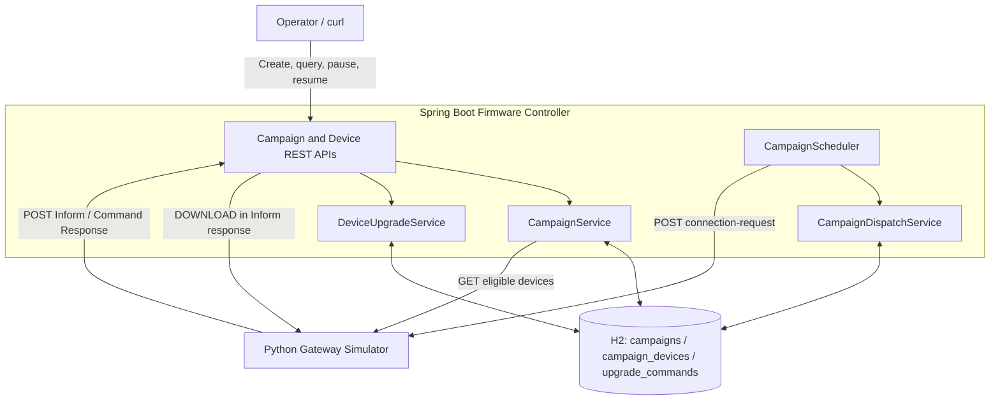
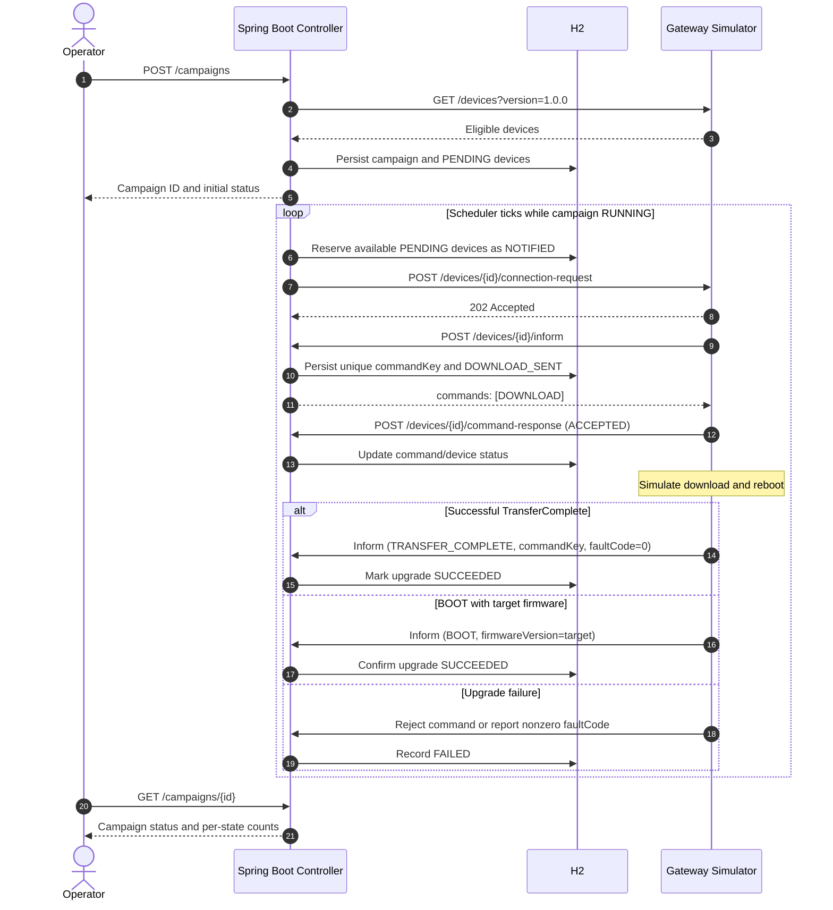
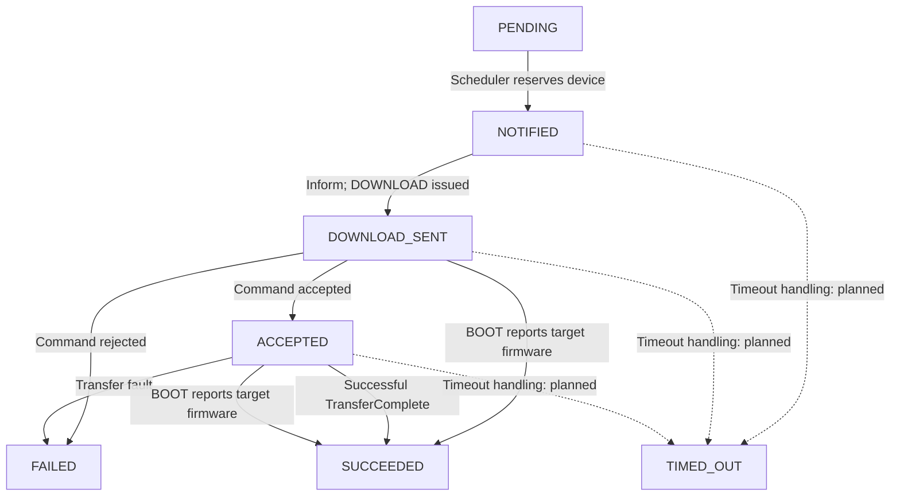

# Firmware Upgrade Campaign Controller

A Java/Spring Boot application for coordinating firmware upgrade campaigns across a fleet of simulated broadband gateways. It provides operator APIs, persistent campaign and device state, a scheduler that limits concurrent upgrades, and asynchronous gateway callback handling.

> **Implementation status:** Campaign management, gateway callback endpoints, command persistence, and an initial single-instance scheduler are implemented. Timeout recovery, automatic failure-threshold enforcement, robust concurrent event handling, and production-scale testing are still in progress.

## Tech Stack

- Java 17 (compile target), Spring Boot 4.1.2, Maven
- Spring Web MVC, Spring Data JPA, Spring Scheduling, Spring Boot Actuator
- File-backed H2 database
- Python, FastAPI, Uvicorn, HTTPX gateway simulator
- Docker and Docker Compose

## Architecture



### Component Responsibilities

| Component | Responsibility |
|---|---|
| `CampaignController` | Operator-facing create, status, pause, and resume APIs |
| `CampaignService` | Load eligible inventory, persist campaigns/devices, summarize progress |
| `CampaignScheduler` | Periodically process running campaigns and send connection requests |
| `CampaignDispatchService` | Reserve pending devices while respecting per-campaign available slots |
| `DeviceController` | Accept gateway Inform and command-response callbacks |
| `DeviceUpgradeService` | Persist DOWNLOAD commands, process acknowledgments and completion events |
| H2 | Persist campaigns, per-device states, and command correlation records |
| Python simulator | Simulate gateway inventory, downloads, reboots, and callback scenarios |

## Firmware Upgrade Sequence



The `deviceId` identifies a gateway. A `commandKey` identifies one specific DOWNLOAD command so that asynchronous responses can be correlated with it.

## Device State Machine



| Device state | Meaning |
|---|---|
| `PENDING` | Eligible; not yet selected for an upgrade |
| `NOTIFIED` | Selected and connection request initiated |
| `DOWNLOAD_SENT` | DOWNLOAD returned in an Inform response |
| `ACCEPTED` | Gateway acknowledged the DOWNLOAD command |
| `SUCCEEDED` | Positive upgrade confirmation received |
| `FAILED` | Rejection or reported transfer error |
| `TIMED_OUT` | Planned terminal state for an expired operation; timeout enforcement remains pending |

> The diagrams describe the implemented happy path and the intended handling of certain failure paths. Comprehensive late-event, duplicate-event, and timeout behavior remains to be hardened.

## Project Structure

```text
src/main/java/device/simulator/
├── DeviceSimulatorApplication.java
├── controller/
│   ├── CampaignController.java
│   └── DeviceController.java
├── dto/
│   ├── CreateCampaignRequest.java
│   ├── CampaignStatusResponse.java
│   ├── DeviceInformRequest.java
│   └── DeviceCommandResponse.java
├── entity/
│   ├── Campaign.java
│   ├── CampaignDevice.java
│   └── UpgradeCommand.java
├── repository/
│   ├── CampaignRepository.java
│   ├── CampaignDeviceRepository.java
│   └── UpgradeCommandRepository.java
├── scheduler/
│   └── CampaignScheduler.java
└── service/
    ├── CampaignService.java
    ├── CampaignDispatchService.java
    └── DeviceUpgradeService.java

src/main/resources/application.yaml
src/test/java/device/simulator/DeviceSimulatorApplicationTests.java
simulator/device_simulator.py
simulator/run-simulator.cmd
campaign-request.json
compose.yml
README.md
```

## Prerequisites

- JDK 17+ (the project targets Java 17 bytecode)
- Maven wrapper (`mvnw.cmd` is included)
- Python 3 and pip
- Optional: Docker Desktop with Docker Compose

Run commands from the project root. On Windows Command Prompt:

```cmd
cd C:\my_springboot\device-simulator
```

## Configuration

Application settings are in `src/main/resources/application.yaml`. The local controller listens on port `8080` and connects to the simulator on port `9000`.

Relevant settings (preserve the other properties already present in your configuration):

```yaml
spring:
  datasource:
    url: jdbc:h2:file:./data/firmwaredb;DB_CLOSE_ON_EXIT=FALSE
    driver-class-name: org.h2.Driver
    username: sa
    password:
  jpa:
    hibernate:
      ddl-auto: update
  h2:
    console:
      enabled: true
      path: /h2-console

simulator:
  base-url: ${SIMULATOR_BASE_URL:http://localhost:9000}

campaign:
  scheduler-delay-ms: 2000
```

The H2 URL is relative to the application working directory. Local and Docker runs may use separate database files or volumes. Do not run two independent controller processes against the same file-based H2 database without an appropriate multi-process access configuration.

For tests, `DeviceSimulatorApplicationTests` uses an in-memory H2 URL so `mvnw.cmd clean package` does not contend with the local persistent database.

### Python Simulator Settings

On Windows, `simulator/run-simulator.cmd` sets the simulator environment variables and launches Uvicorn. No `.env` file is required.

| Variable | Local test value | Purpose |
|---|---|---|
| `CONTROLLER_URL` | `http://localhost:8080` | URL receiving gateway callbacks |
| `DEVICE_COUNT` | `10` | Number of simulated gateways |
| `PERIODIC_INFORM_SEC` | `300` | Periodic Inform interval |
| `DOWNLOAD_MIN_SEC` | `2` | Minimum simulated download delay |
| `DOWNLOAD_MAX_SEC` | `5` | Maximum simulated download delay |
| `REBOOT_MIN_SEC` | `2` | Minimum simulated reboot delay |
| `REBOOT_MAX_SEC` | `5` | Maximum simulated reboot delay |

To change fleet size, edit `DEVICE_COUNT` in the CMD script and restart the simulator. Restarting the simulator resets its in-memory gateway state; persisted controller campaign records are not reset automatically.

## Build and Run Locally

### 1. Install simulator dependencies

```cmd
py -m pip install fastapi uvicorn httpx
```

### 2. Start Spring Boot — terminal 1

```cmd
mvnw.cmd clean package
mvnw.cmd spring-boot:run
```

Health check:

```cmd
curl http://localhost:8080/actuator/health
```

Expected:

```json
{"status":"UP"}
```

### 3. Start Python simulator — terminal 2

```cmd
simulator\run-simulator.cmd
```

Verify inventory in a separate terminal:

```cmd
curl http://localhost:9000/devices
curl "http://localhost:9000/devices?version=1.0.0"
```

With the default test script, the simulator initializes 10 gateways running version `1.0.0`.

### 4. Optional: Run controller in Docker

Stop any local Spring Boot process using port `8080`, then run:

```cmd
mvnw.cmd clean package
docker compose up --build -d
curl http://localhost:8080/actuator/health
```

Stop:

```cmd
docker compose down
```

When the Python simulator runs on the Windows host but Spring Boot runs inside Docker, set the controller's `SIMULATOR_BASE_URL` to `http://host.docker.internal:9000` through the container environment/Compose configuration. The simulator should remain configured to call the host-accessible controller at `http://localhost:8080`.

## REST API Reference

| Method | Endpoint | Purpose |
|---|---|---|
| `POST` | `/campaigns` | Create a new campaign for eligible gateways |
| `GET` | `/campaigns/{id}` | Return campaign status, device counts, and failure rate |
| `POST` | `/campaigns/{id}/pause` | Stop scheduling new devices for a campaign |
| `POST` | `/campaigns/{id}/resume` | Re-enable scheduling |
| `POST` | `/devices/{deviceId}/inform` | Process a gateway event and optionally return a DOWNLOAD command |
| `POST` | `/devices/{deviceId}/command-response` | Record ACCEPTED or REJECTED acknowledgment |

### Create Campaign

Example `campaign-request.json`:

```json
{
  "targetVersion": "2.0.0",
  "imageUrl": "https://example.com/firmware/2.0.0.bin",
  "deviceFilter": {"currentVersion": "1.0.0"},
  "maxConcurrent": 3,
  "failureThresholdPercent": 20
}
```

```cmd
curl -X POST http://localhost:8080/campaigns -H "Content-Type: application/json" --data-binary "@campaign-request.json"
```

An example initial response (the ID is generated dynamically):

```json
{
  "campaignId": "generated-uuid",
  "status": "RUNNING",
  "targetVersion": "2.0.0",
  "totalDevices": 10,
  "deviceCounts": {"PENDING": 10},
  "failureRatePercent": 0.0
}
```

Each POST creates a new campaign, even if request parameters are identical. When testing the scheduler, pause older `RUNNING` campaigns before starting a new campaign to avoid competition for the same simulated gateways.

### Get, Pause, Resume

Replace `CAMPAIGN_ID` with the actual generated ID:

```cmd
curl http://localhost:8080/campaigns/CAMPAIGN_ID
curl -X POST http://localhost:8080/campaigns/CAMPAIGN_ID/pause
curl http://localhost:8080/campaigns/CAMPAIGN_ID
curl -X POST http://localhost:8080/campaigns/CAMPAIGN_ID/resume
curl http://localhost:8080/campaigns/CAMPAIGN_ID
```

The verified status sequence is `RUNNING → PAUSED → RUNNING`. The scheduler selects new devices only for running campaigns; already in-flight devices may still finish after a pause.

### Device Inform

Example Inform when no upgrade is reserved:

```cmd
curl -X POST http://localhost:8080/devices/YOUR_DEVICE_ID/inform -H "Content-Type: application/json" -d "{\"deviceId\":\"YOUR_DEVICE_ID\",\"firmwareVersion\":\"1.0.0\",\"event\":\"PERIODIC\"}"
```

Verified empty-command response:

```json
{"commands":[]}
```

When a gateway is reserved, the response contains a DOWNLOAD command:

```json
{
  "commands": [{
    "type": "DOWNLOAD",
    "commandKey": "generated-command-uuid",
    "url": "https://example.com/firmware/2.0.0.bin",
    "targetVersion": "2.0.0"
  }]
}
```

The controller saves the command key before returning the DOWNLOAD command.

### Command Response

A simulator gateway acknowledges a DOWNLOAD using:

```json
{
  "commandKey": "generated-command-uuid",
  "status": "ACCEPTED"
}
```

A gateway may instead report `REJECTED`, optionally with a reason. The controller persists acknowledgment and device state changes.

### Upgrade Completion

The controller processes `TRANSFER_COMPLETE` and `BOOT` Inform events. A successful TransferComplete or BOOT reporting the target version while a matching upgrade is active can confirm completion. Failure fault codes mark the device as failed. Some out-of-order cases still require hardening.

## Campaign Scheduler

Scheduling is enabled via `@EnableScheduling` and configured with:

```yaml
campaign:
  scheduler-delay-ms: 2000
```

Each tick retrieves running campaigns, counts their in-flight devices, reserves pending devices up to available capacity, and sends simulator connection requests. Reservations are persisted before outgoing HTTP calls. The active states are `NOTIFIED`, `DOWNLOAD_SENT`, and `ACCEPTED`.

```text
availableSlots = maxConcurrent - activeDeviceCount
```

For a campaign configured with `maxConcurrent = 3`, the intended single-instance limit is three simultaneously active devices. A database query shows the current count; full temporal concurrency validation needs repeated sampling or automated tests.

The reservation service also checks for active upgrades on the same gateway across campaigns. This is an initial single-process safeguard, not a substitute for database locking or distributed coordination.

**Known gap:** A failed connection request currently leaves the device `NOTIFIED`; automatic timeout and retry processing is not yet implemented.

## H2 Persistence and Validation

Open `http://localhost:8080/h2-console` when Spring Boot is running locally. Use the application datasource's JDBC URL (typically `jdbc:h2:file:./data/firmwaredb;DB_CLOSE_ON_EXIT=FALSE`), username `sa`, and a blank password.

### Campaigns

```sql
SELECT ID, TARGET_VERSION, SOURCE_VERSION, STATUS, CREATED_AT
FROM CAMPAIGNS
ORDER BY CREATED_AT DESC;
```

### Devices per campaign

```sql
SELECT CAMPAIGN_ID, STATE, COUNT(*) AS DEVICE_COUNT
FROM CAMPAIGN_DEVICES
GROUP BY CAMPAIGN_ID, STATE
ORDER BY CAMPAIGN_ID, STATE;
```

### Device state details

```sql
SELECT DEVICE_ID, CURRENT_VERSION, STATE, ATTEMPTS, LAST_ERROR
FROM CAMPAIGN_DEVICES
WHERE CAMPAIGN_ID = 'YOUR_CAMPAIGN_ID'
ORDER BY DEVICE_ID;
```

### DOWNLOAD commands and correlation keys

```sql
SELECT COMMAND_KEY, CAMPAIGN_ID, DEVICE_ID, TARGET_VERSION, STATUS, FAULT_CODE
FROM UPGRADE_COMMANDS
WHERE CAMPAIGN_ID = 'YOUR_CAMPAIGN_ID';
```

### Current in-flight count

```sql
SELECT COUNT(*) AS IN_FLIGHT
FROM CAMPAIGN_DEVICES
WHERE CAMPAIGN_ID = 'YOUR_CAMPAIGN_ID'
  AND STATE IN ('NOTIFIED', 'DOWNLOAD_SENT', 'ACCEPTED');
```

Campaign creation, pause/resume, and persisted campaign/device records have been validated. SQL queries have also been used to inspect scheduler device states and upgrade command records.

## Testing Status

### Validated so far

- Local Maven build and Spring Boot health endpoint
- Docker Compose startup and health endpoint
- Python simulator startup and 10-device inventory retrieval
- Campaign creation, status, pause, and resume APIs
- H2 persistence of campaigns and their device records
- Device Inform endpoint returning `{"commands":[]}` when no upgrade is assigned
- Scheduler-related device-state and upgrade-command inspection in H2

### Remaining validation

- Full repeated 10-device upgrade run with terminal outcome counts
- Automated assertion of maximum in-flight concurrency throughout the run
- Offline gateway, rejected command, and failed transfer scenarios
- BOOT without TransferComplete; duplicate, delayed, and out-of-order callbacks
- Timeout enforcement and bounded retry behavior
- Automatic failure-threshold halt with a minimum observation sample
- Automatic campaign completion and restart recovery
- A 1,000-device run and documented outcomes/performance

## Observability

Spring Boot Actuator provides a health endpoint and, when exposed in application configuration, a metrics endpoint:

```text
/actuator/health
/actuator/metrics
```

Planned domain-specific metrics include connection requests, commands sent, acknowledgments, successes, failures, timeouts, in-flight counts, and campaign completion durations.

## Design Decisions and Trade-offs

| Decision | Rationale | Limitation / next improvement |
|---|---|---|
| Spring Boot application | Simple deployment and transactional persistence | A single instance limits orchestration scale |
| File-backed H2 | Lightweight, persistent local storage | Use a shared production database for multi-instance deployments |
| Separate campaign/device/command entities | Retain campaign-level configuration, per-device progress, and command correlation | More database operations; useful for audit and recovery |
| Scheduler-based dispatch | Nonblocking orchestration, explicit in-flight limits | Requires timeout/recovery processing and stronger locking |
| Persistent `commandKey` | Correlates asynchronous responses and mitigates duplicate issuance | Late events and races still need more robust rules |
| Firmware version confirmation on BOOT | Supports gateways that omit TransferComplete | Must guard against stale events and unrelated campaigns |
| Pause/resume as campaign status | Prevent new scheduling while allowing in-flight completion | Does not cancel commands already issued |

## Scaling Considerations

For fleets measured in millions of gateways, the local design would need shared persistence, partitioned campaign work, distributed leasing/locking, bounded request rates, queue- or event-driven callback processing, durable retry/dead-letter handling, observability, and explicit backpressure. A production implementation would also require authentication/authorization, firmware artifact validation, and operational audit history.

## Implementation Status

### Completed

- Spring Boot 4.1.2 project, Java 17 target, Maven, Docker Compose
- H2 file-backed persistence, JPA entities and repositories
- Campaign create/status/pause/resume APIs and simulator inventory integration
- Device Inform and Command Response endpoints
- Persistent DOWNLOAD command keys and acknowledgment handling
- BOOT and TransferComplete handlers for the initial upgrade flow
- Initial scheduled campaign dispatch with per-campaign slot calculation
- Initial protection against overlapping in-flight upgrades in one controller instance
- Manual API and H2 validation of implemented functionality
- Architecture, sequence, and state-machine diagrams

### In Progress / Planned

- Expired-operation detection and bounded retries
- Failure-threshold enforcement and campaign completion status
- Stronger concurrent callback, duplicate, and late-event handling
- Controller restart/in-flight recovery validation
- Domain-specific metrics and end-to-end run report
- Larger fleet validation (including 1,000 simulated gateways)
