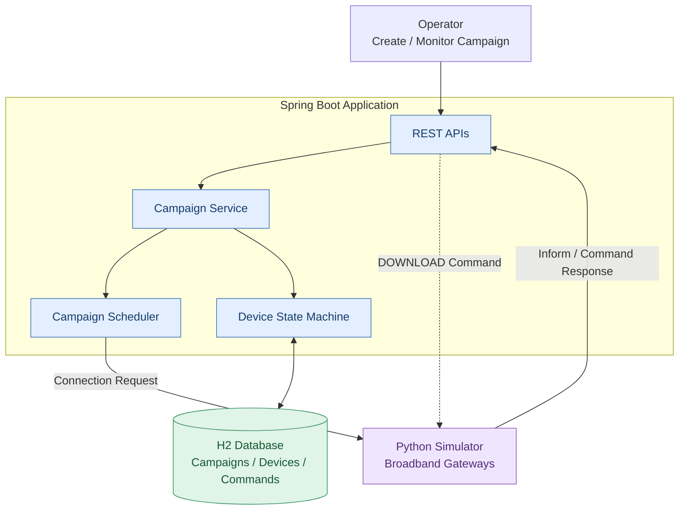
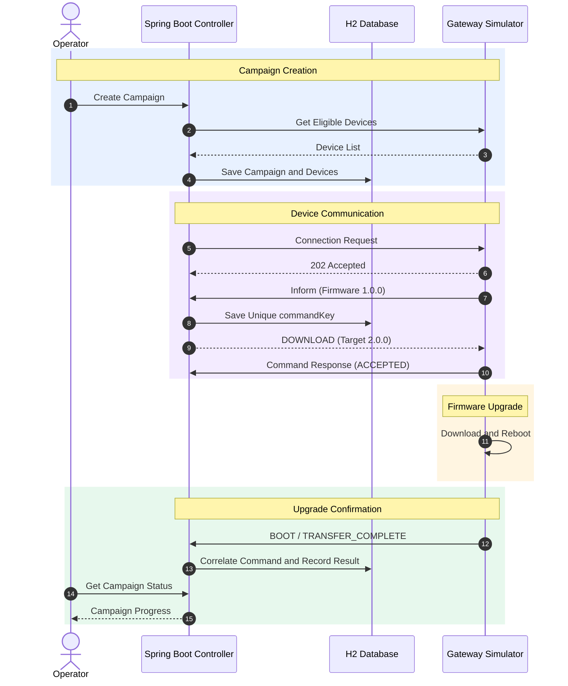
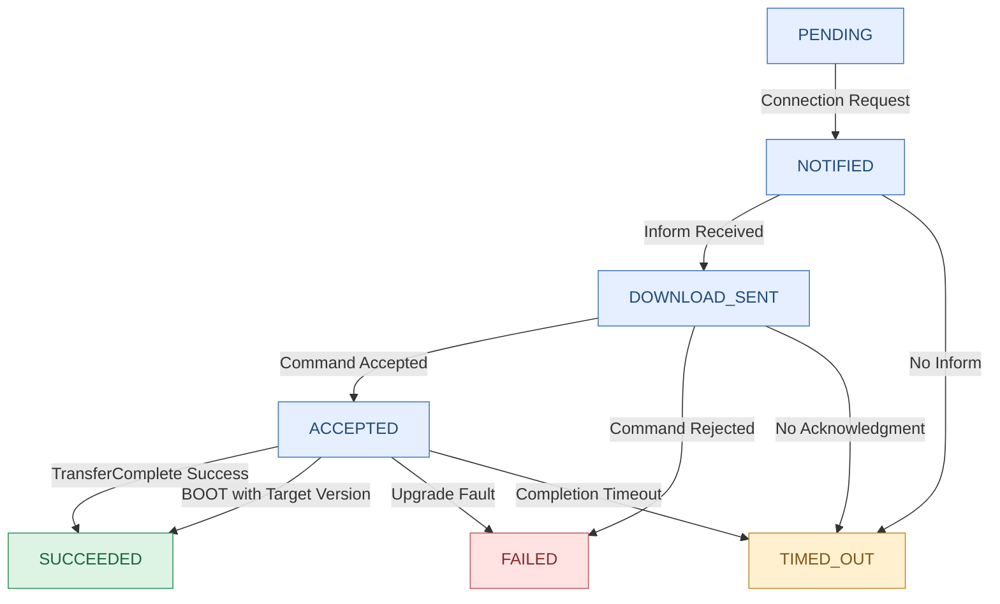

# Firmware Upgrade Campaign Controller

## Overview

Spring Boot-based firmware upgrade campaign management application.

The system manages firmware upgrades across simulated broadband gateways, tracks device progress, handles asynchronous responses, and provides campaign status reporting.

## Tech Stack

- Java 17
- Spring Boot 4.1.2
- Maven
- Spring Web MVC
- Spring Data JPA
- H2 file-based database
- Spring Boot Actuator
- Spring Scheduler
- Python FastAPI device simulator
- Docker
- Docker Compose

## Architecture

The application consists of a Spring Boot controller, an H2 database, and a Python-based device simulator.



### Components

- **REST APIs:** Handle campaign requests and device callbacks.
- **Campaign Service:** Manages upgrade campaigns and business rules.
- **Campaign Scheduler:** Controls upgrade execution and concurrency.
- **Device State Machine:** Tracks each device's upgrade progress.
- **H2 Database:** Stores campaigns, device states, and command details.
- **Python Simulator:** Simulates gateway firmware upgrades, reboots, and failures.

## Firmware Upgrade Sequence



### Upgrade Flow

1. An operator creates a firmware upgrade campaign.
2. The controller retrieves eligible gateways from the simulator.
3. The scheduler sends connection requests.
4. Gateways initiate sessions using the Inform API.
5. The controller returns a DOWNLOAD command with a unique `commandKey`.
6. Gateways acknowledge the command, download firmware, and reboot.
7. The controller processes completion events and updates device status.

The `deviceId` identifies a gateway, while the `commandKey` uniquely identifies an upgrade command.

## Device State Machine



### State Descriptions

| State | Description |
|---|---|
| PENDING | Gateway is eligible but has not been contacted |
| NOTIFIED | Connection request sent |
| DOWNLOAD_SENT | Download command issued |
| ACCEPTED | Gateway accepted the download command |
| SUCCEEDED | Firmware upgrade confirmed |
| FAILED | Upgrade rejected or failed |
| TIMED_OUT | Device did not respond within the configured deadline |

## Package Structure

Planned package structure:

```text
device.simulator
├── controller
├── dto
├── entity
├── repository
├── service
├── scheduler
└── exception
```

## Design Decisions

- **Single Spring Boot application**
  - **Why:** Simple architecture with fewer deployment dependencies.
  - **Trade-off:** No horizontal scaling in the initial implementation.

- **H2 file-based database**
  - **Why:** Lightweight database with straightforward Spring Data JPA integration.
  - **Trade-off:** A shared relational database would be preferred for multiple production instances.

- **Scheduler-based processing**
  - **Why:** Manages asynchronous upgrades without blocking application threads.
  - **Trade-off:** Scheduling frequency affects execution responsiveness.

- **Unique commandKey**
  - **Why:** Correlates device acknowledgments and completion callbacks.
  - **Trade-off:** Requires persistent command tracking and idempotency handling.

- **Firmware version-based confirmation**
  - **Why:** Supports gateways that reboot successfully without sending TransferComplete.
  - **Trade-off:** Requires additional validation of reported firmware versions.

- **Configurable retries and timeouts**
  - **Why:** Handles offline and unresponsive devices.
  - **Trade-off:** Late callbacks may arrive after timeout decisions.

## REST APIs

| Method | Endpoint | Description |
|---|---|---|
| POST | `/campaigns` | Create firmware upgrade campaign |
| GET | `/campaigns/{id}` | Retrieve campaign status |
| POST | `/campaigns/{id}/pause` | Pause campaign |
| POST | `/campaigns/{id}/resume` | Resume campaign |
| POST | `/devices/{deviceId}/inform` | Process device Inform event |
| POST | `/devices/{deviceId}/command-response` | Process command acknowledgment |

## Campaign Request Example

```json
{
  "targetVersion": "2.0.0",
  "imageUrl": "https://example.com/firmware/2.0.0.bin",
  "deviceFilter": {
    "currentVersion": "1.0.0"
  },
  "maxConcurrent": 50,
  "failureThresholdPercent": 20
}
```

## Testing Approach

Testing will include:

- Unit tests for campaign and device state transitions
- Integration tests for REST APIs
- Duplicate and delayed callbacks
- Successful and failed firmware upgrades
- Timeout and retry scenarios
- Maximum concurrent upgrades
- Automatic campaign halt
- Controller restart and database persistence
- End-to-end tests using 10–20 simulated gateways
- Full-fleet validation using 1,000 gateways

## Limitations and Trade-offs

- H2 is intended for local development and single-instance operation.
- The simulator does not download actual firmware images.
- The initial implementation uses a single application instance.
- Production authentication and authorization are outside the initial scope.
- Distributed scheduling and shared persistence would be needed at larger scale.

## Run Locally

### Maven

Build and test:

```cmd
mvnw.cmd clean package
```

Start:

```cmd
mvnw.cmd spring-boot:run
```

Verify:

```cmd
curl http://localhost:8080/actuator/health
```

Expected:

```json
{
  "status": "UP"
}
```

### Docker Compose

Build:

```cmd
mvnw.cmd clean package
```

Start:

```cmd
docker compose up --build -d
```

Verify:

```cmd
curl http://localhost:8080/actuator/health
```

Stop:

```cmd
docker compose down
```

## Observability

Spring Boot Actuator provides health checks and application metrics.

- `/actuator/health`
- `/actuator/metrics`

Additional metrics will track connection requests, download commands, successful upgrades, failures, and timeouts.

## Implementation Status

**Completed:**
- Spring Boot project initialization
- Maven build and local execution
- Docker Compose setup
- Health endpoint validation

**Planned:**
- Campaign and device entities
- Database repositories
- REST API implementation
- Campaign scheduler
- Upgrade state machine
- Failure handling and metrics
- Simulator integration and end-to-end testing
