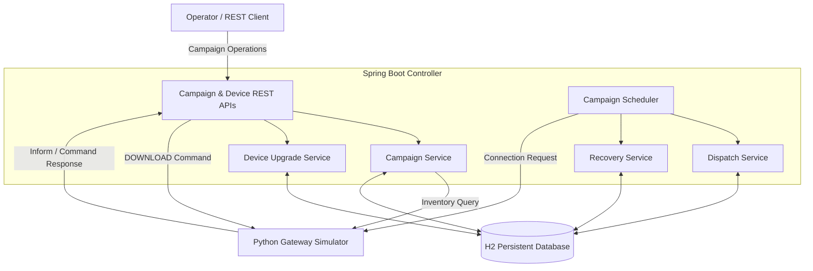
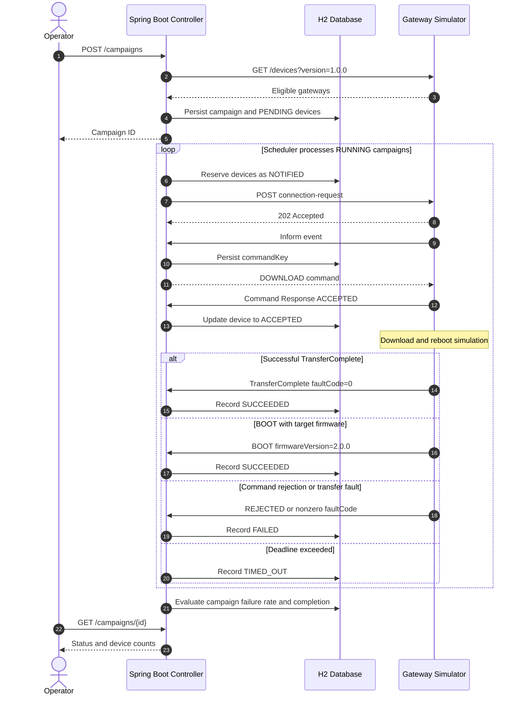
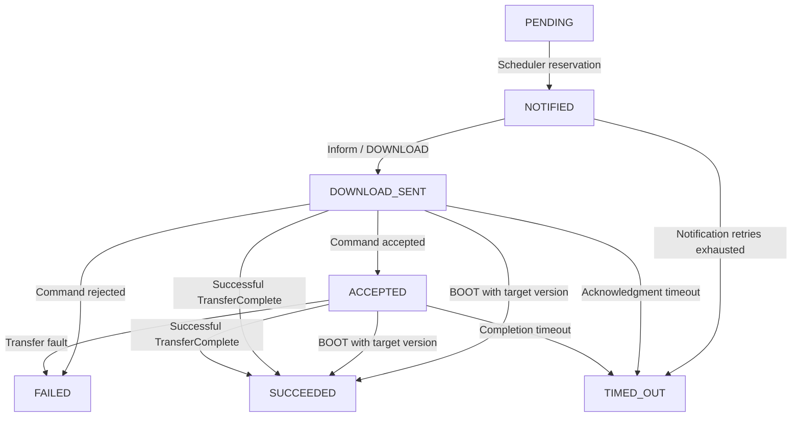

# Firmware Upgrade Campaign Controller

A Spring Boot-based firmware upgrade campaign management application for orchestrating firmware updates across simulated broadband gateways.

The application provides persistent campaign tracking, device communication, DOWNLOAD command processing, configurable concurrency, timeout recovery, failure-threshold protection, and campaign lifecycle management.

## 1. Technology Stack

| Component | Technology |
|---|---|
| Language | Java 17 |
| Framework | Spring Boot 4.1.2 |
| Build | Maven |
| REST APIs | Spring Web MVC |
| Persistence | Spring Data JPA |
| Database | H2 (file-based) |
| Scheduling | Spring Scheduling |
| Health Monitoring | Spring Boot Actuator |
| Gateway Simulator | Python FastAPI |
| Simulator Server | Uvicorn |
| HTTP Client | HTTPX / Spring RestClient |
| Containerization | Docker / Docker Compose |

## 2. System Architecture



### Component Responsibilities

| Component | Responsibility |
|---|---|
| CampaignController | Create, retrieve, pause and resume campaigns |
| CampaignService | Campaign creation, inventory retrieval and progress reporting |
| DeviceController | Receive gateway Inform and command-response callbacks |
| DeviceUpgradeService | Issue DOWNLOAD commands, correlate responses and record upgrade outcomes |
| CampaignDispatchService | Reserve devices and enforce in-flight limits |
| CampaignRecoveryService | Detect timeouts, perform notification retries and evaluate campaign outcomes |
| CampaignScheduler | Periodically execute recovery and dispatch |
| H2 Database | Persist campaign, device and command information |
| Python Simulator | Simulate gateway communication, upgrades, reboots and failures |

## 3. Firmware Upgrade Sequence



## 4. Device Upgrade State Machine



### Device States

| State | Description |
|---|---|
| PENDING | Device is eligible but not scheduled |
| NOTIFIED | Connection request initiated; waiting for Inform |
| DOWNLOAD_SENT | DOWNLOAD command issued |
| ACCEPTED | Gateway acknowledged the command |
| SUCCEEDED | Firmware upgrade reported successful |
| FAILED | Command rejected or upgrade fault occurred |
| TIMED_OUT | Device failed to respond within configured deadlines |

`SUCCEEDED`, `FAILED`, and `TIMED_OUT` are terminal device outcomes in the current MVP.

## 5. Project Structure

```text
device-simulator/
├── src/
│   ├── main/
│   │   ├── java/device/simulator/
│   │   │   ├── DeviceSimulatorApplication.java
│   │   │   ├── controller/
│   │   │   │   ├── CampaignController.java
│   │   │   │   └── DeviceController.java
│   │   │   ├── dto/
│   │   │   │   ├── CreateCampaignRequest.java
│   │   │   │   ├── CampaignStatusResponse.java
│   │   │   │   ├── DeviceInformRequest.java
│   │   │   │   └── DeviceCommandResponse.java
│   │   │   ├── entity/
│   │   │   │   ├── Campaign.java
│   │   │   │   ├── CampaignDevice.java
│   │   │   │   └── UpgradeCommand.java
│   │   │   ├── repository/
│   │   │   │   ├── CampaignRepository.java
│   │   │   │   ├── CampaignDeviceRepository.java
│   │   │   │   └── UpgradeCommandRepository.java
│   │   │   ├── service/
│   │   │   │   ├── CampaignService.java
│   │   │   │   ├── CampaignDispatchService.java
│   │   │   │   ├── CampaignRecoveryService.java
│   │   │   │   └── DeviceUpgradeService.java
│   │   │   └── scheduler/
│   │   │       └── CampaignScheduler.java
│   │   └── resources/
│   │       └── application.yaml
│   └── test/java/device/simulator/
│       └── DeviceSimulatorApplicationTests.java
├── simulator/
│   ├── device_simulator.py
│   └── run-simulator.cmd
├── campaign-request.json
├── compose.yml
├── mvnw.cmd
└── README.md
```

## 6. Application Configuration

Application configuration is maintained in `src/main/resources/application.yaml`.

### Database Configuration

```yaml
spring:
  datasource:
    url: jdbc:h2:file:./data/firmwaredb;DB_CLOSE_ON_EXIT=FALSE
    driver-class-name: org.h2.Driver
    username: sa
    password:

  jpa:
    hibernate:
      ddl-auto: update

  h2:
    console:
      enabled: true
      path: /h2-console
```

### Simulator and Scheduler Configuration

```yaml
simulator:
  base-url: ${SIMULATOR_BASE_URL:http://localhost:9000}

campaign:
  scheduler-delay-ms: 2000
  max-notification-attempts: 3
  notification-timeout-seconds: 15
  acknowledgment-timeout-seconds: 20
  upgrade-timeout-seconds: 90
  failure-min-sample-size: 5
```

These settings are optimized for local MVP testing rather than production deployment.

## 7. Build and Run

### Prerequisites

- JDK 17 or later
- Python 3
- Docker Desktop (optional)
- Maven wrapper included with the project

### Build Application

From the project root:

```cmd
cd C:\my_springboot\device-simulator
mvnw.cmd clean package
```

### Start Spring Boot

```cmd
mvnw.cmd spring-boot:run
```

The controller runs at `http://localhost:8080`.

Verify health:

```cmd
curl http://localhost:8080/actuator/health
```

Expected:

```json
{"status":"UP"}
```

### Run with Docker Compose

```cmd
mvnw.cmd clean package
docker compose up --build -d
```

Verify:

```cmd
curl http://localhost:8080/actuator/health
```

Stop:

```cmd
docker compose down
```

If the controller runs in Docker and the Python simulator runs directly on Windows, configure the simulator URL through the container environment using `http://host.docker.internal:9000`.

## 8. Python Gateway Simulator

### Install Dependencies

```cmd
py -m pip install fastapi uvicorn httpx
```

### Windows Startup Script

File: `simulator/run-simulator.cmd`

```bat
@echo off
cd /d "%~dp0.."

set CONTROLLER_URL=http://localhost:8080
set DEVICE_COUNT=10
set PERIODIC_INFORM_SEC=300
set DOWNLOAD_MIN_SEC=2
set DOWNLOAD_MAX_SEC=5
set REBOOT_MIN_SEC=2
set REBOOT_MAX_SEC=5

py -m uvicorn device_simulator:app --app-dir simulator --port 9000
```

Start the simulator:

```cmd
simulator\run-simulator.cmd
```

The simulator listens on port `9000`.

### Verify Inventory

```cmd
curl http://localhost:9000/devices
```

Filter by firmware version:

```cmd
curl "http://localhost:9000/devices?version=1.0.0"
```

The local configuration initializes ten simulated gateways running firmware version `1.0.0`.

## 9. REST APIs

| Method | Endpoint | Description |
|---|---|---|
| POST | `/campaigns` | Create campaign |
| GET | `/campaigns/{id}` | Retrieve campaign progress |
| POST | `/campaigns/{id}/pause` | Pause campaign |
| POST | `/campaigns/{id}/resume` | Resume campaign |
| POST | `/devices/{deviceId}/inform` | Process Inform and return commands |
| POST | `/devices/{deviceId}/command-response` | Process command acknowledgment |

### Create Campaign

Create `campaign-request.json`:

```json
{
  "targetVersion": "2.0.0",
  "imageUrl": "https://example.com/firmware/2.0.0.bin",
  "deviceFilter": {
    "currentVersion": "1.0.0"
  },
  "maxConcurrent": 3,
  "failureThresholdPercent": 20
}
```

Execute:

```cmd
curl -X POST http://localhost:8080/campaigns -H "Content-Type: application/json" --data-binary "@campaign-request.json"
```

Example initial response:

```json
{
  "campaignId": "generated-uuid",
  "status": "RUNNING",
  "targetVersion": "2.0.0",
  "totalDevices": 10,
  "deviceCounts": {
    "PENDING": 10
  },
  "failureRatePercent": 0.0
}
```

### Retrieve Campaign Status

```cmd
curl http://localhost:8080/campaigns/CAMPAIGN_ID
```

### Pause Campaign

```cmd
curl -X POST http://localhost:8080/campaigns/CAMPAIGN_ID/pause
```

Expected status: `PAUSED`.

### Resume Campaign

```cmd
curl -X POST http://localhost:8080/campaigns/CAMPAIGN_ID/resume
```

Expected status: `RUNNING`.

## 10. Device Inform and DOWNLOAD Processing

Example Inform request:

```json
{
  "deviceId": "DEVICE_ID",
  "firmwareVersion": "1.0.0",
  "event": "PERIODIC"
}
```

When no upgrade is assigned:

```json
{
  "commands": []
}
```

When a gateway is reserved for upgrade:

```json
{
  "commands": [
    {
      "type": "DOWNLOAD",
      "commandKey": "generated-command-uuid",
      "url": "https://example.com/firmware/2.0.0.bin",
      "targetVersion": "2.0.0"
    }
  ]
}
```

The controller persists the command key before returning the DOWNLOAD command.

### Command Response

```json
{
  "commandKey": "generated-command-uuid",
  "status": "ACCEPTED"
}
```

Rejections and transfer faults produce failed device outcomes.

Successful TransferComplete or qualifying BOOT events produce successful outcomes.

## 11. Campaign Scheduler

The scheduler periodically processes active campaigns and:

1. Recovers expired operations.
2. Evaluates failure thresholds and completion status.
3. Determines available upgrade capacity.
4. Reserves pending gateways.
5. Sends connection requests to the simulator.
6. Processes asynchronous gateway callbacks through DeviceController.

### Concurrency Control

The following states count as in-flight:

- NOTIFIED
- DOWNLOAD_SENT
- ACCEPTED

Available capacity is calculated as:

```text
availableSlots = maxConcurrent - inFlightDevices
```

A campaign with `maxConcurrent = 3` is designed to schedule at most three concurrent upgrades during normal single-instance execution.

## 12. Timeout Recovery and Retries

| State | Recovery Behavior |
|---|---|
| NOTIFIED | Retry connection request up to configured maximum |
| DOWNLOAD_SENT | Mark TIMED_OUT after acknowledgment deadline |
| ACCEPTED | Mark TIMED_OUT after completion deadline |
| SUCCEEDED | Terminal — no retry |
| FAILED | Terminal — no retry |
| TIMED_OUT | Terminal — no retry |

Connection requests can be retried because they are requests for the gateway to establish a session.

DOWNLOAD commands are not automatically resent when their delivery outcome is uncertain. This limits the risk of duplicate firmware operations.

Timeout recovery persists the terminal outcome and releases the device's in-flight capacity.

## 13. Failure Threshold and Campaign Completion

### Failure Rate

The controller calculates the failure rate from terminal outcomes:

```text
failureRatePercent =
    (FAILED + TIMED_OUT) /
    (SUCCEEDED + FAILED + TIMED_OUT) * 100
```

### Automatic Halt

The controller evaluates the failure threshold after the configured minimum sample size.

For example:

```text
failureThresholdPercent = 20
failureMinSampleSize = 5
```

When the observed failure rate exceeds the configured threshold, the campaign transitions to:

`HALTED`

The scheduler stops selecting new devices, while previously initiated operations can still report outcomes.

### Campaign Completion

When all enrolled devices have reached a terminal state, the campaign transitions to:

`COMPLETED`

A completed campaign may include successful, failed and timed-out gateways.

## 14. H2 Database Validation

Open `http://localhost:8080/h2-console